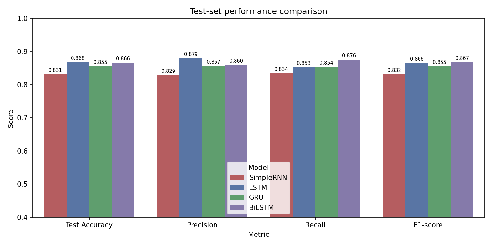

# Sentiment Analysis with RNN, LSTM, GRU and BiLSTM

**A Comparative Study of RNN, LSTM, GRU and BiLSTM Models for Sentiment Analysis of IMDB Movie Reviews**

Deep Learning course project, B.Tech CSE, SRM University – AP
**Team:** Harsha Siva Akash Saladi (AP23110011490), Kishan Bhimavarapu (AP23110011351)
**Guide:** Dr. Lalit Kumar, Assistant Professor, Department of CSE

---

## What this project does
It classifies IMDB movie reviews as **positive** or **negative**, and compares four recurrent neural networks trained under identical settings:

| Model | Accuracy | Precision | Recall | F1 | Train time |
|---|---|---|---|---|---|
| SimpleRNN | 83.12% | 0.829 | 0.834 | 0.832 | 95 s |
| **LSTM** | **86.76%** | **0.879** | 0.853 | 0.866 | 296 s |
| GRU | 85.54% | 0.857 | 0.854 | 0.855 | 272 s |
| BiLSTM | 86.62% | 0.860 | **0.876** | **0.867** | 537 s |

**Findings:** gated models beat the basic RNN by 2.4–3.6%. GRU nearly matches LSTM at lower cost. BiLSTM costs 1.8× LSTM's training time for no accuracy gain.



## How to run
Run these in PowerShell or a terminal **inside this folder**:

```bash
pip install -r requirements.txt            # 1. install the libraries (once)
python 1_code/sentiment_rnn_lstm_gru.py    # 2. train all 4 models -> 2_results/ (~20 min on CPU)
python 1_code/predict.py                   # 3. live demo: type a review, get Positive/Negative
```

## Project structure
```
1_code/                          ▶ the code
   sentiment_rnn_lstm_gru.py       main: data, 4 models, training, evaluation, plots
   predict.py                      live demo on your own sentences
   make_dfd.py                     draws the system design (DFD) diagram
   build_reports.py                rebuilds the college report (Word + LaTeX)
2_results/                       ▶ outputs: figures, results_table.csv, demo_predictions.csv, model/
3_report/                        ▶ college project report (SRM AP format)
   Final_Project_Report.pdf/.docx
   latex/                          same report in LaTeX (Overleaf-ready)
4_research_paper_IEEE/           ▶ IEEE conference-format research paper (main.tex + main.pdf)
5_presentation/                  ▶ for the presentation and viva
   Presentation_Script_and_Viva.md what to run, presentation script, viva Q&A
   Concepts_and_Formulas.md        every concept and formula explained from basics
```

## Method (in short)
IMDB (50k reviews) → top-10k vocabulary → pad to 200 tokens → Embedding(64) → **SimpleRNN / LSTM / GRU / BiLSTM (64 units)** → Dropout(0.5) → Dense(sigmoid).
Training uses Adam, binary cross-entropy, batch size 128, up to 5 epochs, and early stopping (patience 2), with seed 42.

## Tools
Python 3.11 · TensorFlow/Keras · scikit-learn · Pandas · Matplotlib · Seaborn
